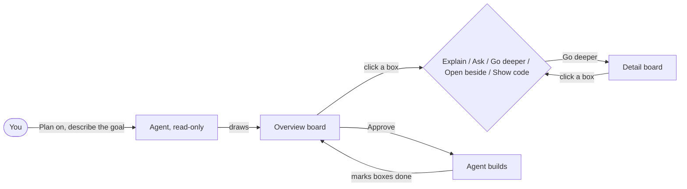
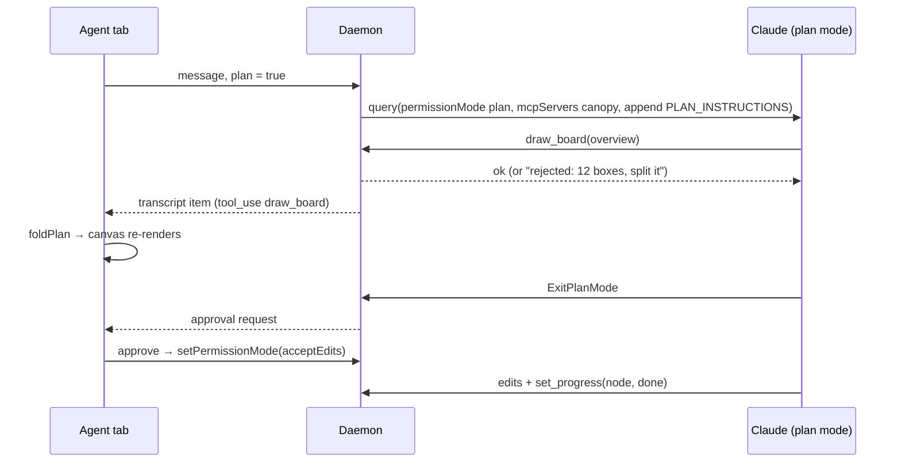
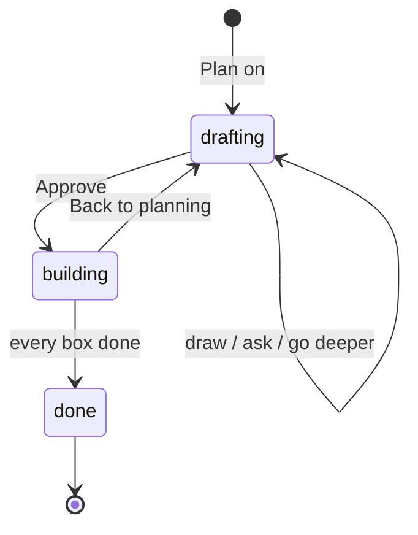

# Plan mode: a whiteboard you read instead of code

Status: **built (2026-10-12)** on `feat/plan-mode`, Claude only. The sections below are the design;
"What was built" at the end records where the build differs and what was learned running it.

## The idea in one paragraph

When you ask Claude (and later Codex) to plan a change, it should not hand back a wall of
markdown. It should draw the plan on a **whiteboard** and explain it in plain words. You start
from the big picture: a few boxes for the parts of the system involved and arrows for how they
connect. Any box can be opened to see what sits inside it, on the same whiteboard or in a panel
on the right. You can ask a question about one box, ask the agent to go deeper, or look at the
code behind it. When you approve the plan, the agent builds it, and the same whiteboard becomes
the progress tracker: boxes light up as the work on them gets done.

The principle behind every choice below: **nobody reads the code, but everybody reads the plan.**
So the plan is written for a reader who does not know the system or its implementation. It
explains, it defines its terms, and it says *why*, not only *what*.

## How it feels to use

1. In the Agent tab composer you switch on **Plan**. The agent can now read the code but cannot
   change it.
2. You describe what you want. The agent explores the code, then draws the **overview board**: one
   diagram with five to nine boxes and a short story beside it, along the lines of "Today a
   message goes from the composer to the daemon, which… To add X we change these three parts."
3. You click a box. A small menu offers:
   - **Explain**: a plain-language paragraph about what this part is and why the plan touches it.
   - **Ask**: your question goes to the agent tagged with this box, and the answer is shown on
     the box.
   - **Go deeper**: the agent reads the code behind the box and draws a **detail board** for it.
     The detail board appears on the whiteboard next to its parent, joined by a dashed line.
   - **Open beside**: the box's detail board opens as its own panel on the right, so you can
     keep the overview in view. You can have several of these open at once.
   - **Show code**: opens the files and lines the box stands for.
4. When you are happy, you click **Approve plan**. The agent switches to editing and starts
   building.
5. While it builds, each box shows *not started*, *in progress* or *done*. Clicking a box that
   is done shows exactly what changed in its files.



## Writing for a reader who doesn't know the system

This is part of the agent's contract, not a matter of style. The drawing tools *require* these
fields and reject a drawing that leaves them out, the same way the experiment rejected bad drawings
(see below):

- **Every board has a story**: two to five short paragraphs read alongside the diagram, covering
  what the reader is looking at, how it works today, what changes, and why. The diagram supports
  the story, and the story does not assume you can read the diagram.
- **Every box has an `explain` field**: one or two sentences in everyday words ("The daemon is the
  background program that runs agents and talks to git"). Code names may appear, but always after
  the plain description, never in place of it.
- **No glossary needed**: the agent prefers the everyday word, and when a technical one cannot be
  avoided it says what it is in the same sentence. (A glossary was built first and dropped: the
  reader wanted the writing itself to be plain.)
- **Decisions are spelled out**: whenever the plan picks one approach over another, a
  "Why this way?" note on the box gives the alternative and the reason.
- **Risks and unknowns are boxes too**, drawn in the attention colour, so they are not buried in
  prose.
- **Code is evidence, not the explanation**: boxes cite `path:line` so you *can* check them, but
  reading the plan never requires opening code.

The agent instructions (`PLAN_INSTRUCTIONS` in `packages/shared/src/plan/prompt.ts`) also say: prefer
short sentences, explain each piece before naming it in code, and keep each board to one level of
detail. If a box needs more than two sentences, it should get its own detail board.

## Which diagrams the agent can draw

The agent writes **Mermaid**, and Canopy draws its own clickable boxes from it. Models already
write Mermaid fluently, and a Mermaid board costs roughly a third to a fifth of the tokens of the
same board as JSON. Canopy reads a documented subset (`packages/shared/src/plan/mermaid.ts`). It
skips styling and reports any line it cannot read by line number, so the agent fixes just that
line.

| Mermaid the agent writes | What it means | Drawn as |
|---|---|---|
| `flowchart` | the parts involved and how they connect | change map |
| `flowchart` with `{decisions}` or `((start/end))` | step-by-step logic | activity diagram (**new**) |
| `sequenceDiagram` | who calls whom, in order | call flow |
| `stateDiagram-v2` | a lifecycle | state machine (**new**) |
| `erDiagram` | stored data | data model |
| `classDiagram` | types and how they relate | data model |

The Mermaid holds only the shape of the drawing. Everything a reader needs is kept **beside** it,
in the tool call, and keyed by box id: the story, a note per box (`explain`, `why`, `status`,
`ref`). So the diagram stays plain Mermaid, and changing the words never means
resending the drawing, or the other way round.

Limits per board: 9 boxes, or 6 participants and 12 messages for a sequence. Past a limit the tool
tells the agent to split the board, which is exactly the drill-down we want.

## Keeping the token cost down

| Saving | How |
|---|---|
| Mermaid, not JSON | The diagram is written in the language models know best, at a fraction of the size. |
| Edits send only what changes | `edit_board` takes just the Mermaid lines for boxes and arrows that change: a box line replaces that box, an arrow line replaces the arrow between the same two boxes, and `remove` deletes boxes or `a->b` arrows. Notes are patched by box id. The only exception is a sequence's messages, which are short and ordered, so they are replaced as a whole. |
| Words apart from the drawing | Story and notes are separate fields, so a wording fix never resends the diagram. |
| Short tool replies | A successful call answers in one line (`Drawn: board "overview" v1, 5 boxes.`). Each reply stays in the context for the rest of the session, so this saves on every later turn. |
| Drill-down on demand | The agent draws only the overview; detail boards come when you ask for them. |
| Explain is free | Clicking **Explain** shows the stored note and makes no model call. Only **Ask** and **Go deeper** reach the agent. |
| Box questions by reference | A question about a box sends a short tag (`<canopy-box ref="overview/d">`), not the box's contents, because the agent already has the board in its context. |
| Cached instructions | The rules live in the appended system prompt (`PLAN_INSTRUCTIONS`), so they are cached. The tool descriptions are one line each. |
| Progress in batches | `set_progress` marks many boxes in one call. |
| Problems, not essays | A refused call lists exact problems, and the prompt says to fix exactly those with no apology. |

## How it works underneath

### The agent draws with tools, not text

The generative-UI experiment (`exp/generative-ui`, report in that worktree under
`docs/experiments/generative-ui/`) showed why tool calls are better than fenced blocks: a bad
drawing is rejected and handed back to the agent, which fixes it in the same turn.

| Tool | What it does |
|---|---|
| `draw_board({ id, parent?, title, story, mermaid, before?, notes })` | Creates a board, or redraws one whole. `parent` is `board/box` for a detail board; `before` is the same picture as things are today. |
| `edit_board({ id, mermaid?, remove?, notes?, story?, title?, before? })` | Changes part of a board. Keeps the old version. |
| `ask_decision({ id, about?, question, context, options })` | Puts a choice on the board: plain question and context, two to four options each with what it changes and an optional picture. |
| `link_decision({ decision, how, ref })` | While building: records how a decision was carried out and where in the code. |
| `set_progress({ doing?, done? })` | While building, marks boxes by `board/box`. |

One pure function, `applyCall(state, tool, input)` in `packages/shared/src/plan/apply.ts`, handles
all three. The daemon runs it to answer the agent, and the client runs it to replay a transcript,
so both always agree. These tools are served by an in-process MCP server called `canopy`, passed
to the Claude SDK only on plan turns, with the experiment's fixes: no zod defaults at the top
level, `ENABLE_TOOL_SEARCH=false`, and instructions through `systemPrompt.append`. The daemon also
checks that every `ref` path exists in the worktree, unless the box is marked `new`.

Questions the agent asks you go through Claude's existing `AskUserQuestion`, which the Agent tab
already renders (`lib/ask-questions.ts`).

### Approval

Claude's own plan mode ends when the agent calls `ExitPlanMode`, which arrives through
`canUseTool` like any other request for permission. Canopy shows it as an **Approve plan** bar
over the whiteboard instead of a markdown block. Approving answers `allow` with `autonomy: edit`,
which the daemon turns into the SDK's `updatedPermissions: [{ type: 'setMode', mode: 'acceptEdits' }]`
on that very answer, so the same turn goes on to build. "Keep planning" answers `deny` with your
note.

Codex has no `ExitPlanMode`, so for Codex a `submit_plan` tool will raise the same approval
request. The approval bar takes a plain `{ approve, reject }` pair and does not care which agent
asked.

### The transcript is the source of truth

There is no new plans table for the content. A plan is just what you get by **replaying the
session's tool calls**: every `draw_board` call adds or replaces a board, and every `set_progress`
call updates a box. One pure function does this:

```
foldPlan(transcriptItems) → { boards, decisions, links, progress, asked, questions, document, approved }
```

This means that rejoining a running session, reopening an old one, and browsing history all work
with no extra code, because the Agent tab already loads transcripts. The only new stored data is
**where you dragged things** on the whiteboard, which is kept per session in a small
`plan_layouts` table so it follows you across devices.



### Progress while it builds

Boxes change state in two ways. The agent says so with `set_progress`, and Canopy already knows
which files each turn wrote (`TranscriptItem.files`, edit snapshots). If a box's cited files were
edited but the agent never marked it, the box shows *in progress* anyway. Clicking a done box
opens the existing `DiffExplorer` filtered to that box's files, the same way per-turn changes work
today.



### The whiteboard and the side panels

- **The whiteboard** is nessa's `workflow-canvas` (infinite pan and zoom, draggable nodes with
  any content). Each *board* is one canvas node that holds a rendered diagram. Detail boards are
  placed next to their parent box by a pure `placeBoard(parent, siblings)` function and joined
  by a dashed edge. Your drags override the placement.
- **Open beside** opens a board as a PanelShell panel with id `plan-board:<id>`, using the same
  mechanism the Agent tab already uses to open sessions beside each other. Any number of panels
  can be open; each is the same `BoardView` the canvas uses, so there is one renderer.
- **The story** sits in the board's header and expand on click, so the canvas stays
  readable when zoomed out.
- A **minimap** and a **board list** (outline of the tree: Overview › Daemon › TurnHub) help you
  find your way once there are many boards.

## What gets built, in order

Each step ends with something that works and can be tried.

1. **Contract** (`packages/shared/src/plan/`, done). The Mermaid reader, the board model and
   tool inputs, `applyCall` (draw, edit and progress, with reader-first checks and size limits),
   `foldPlan`, `boardDrawing` (a board as a Canopy drawing) and the prompt. 19 unit tests.
2. **Drawings in nessa_ui first** (the nessa-ui-first rule). New `state-machine` and `activity`
   components; a compact top-to-bottom layout for narrow panels; a "board" node for
   `workflow-canvas` (header with story, body with any diagram, dashed parent edge); stories and
   registry entries. Vendor into Canopy with `ui:add`. Nothing gets pushed upstream without your
   say-so.
3. **Daemon**. The `canopy` MCP server with `draw_board` and `set_progress` (ported from the
   experiment's `genui/tools.ts`), path checking, `PLAN_INSTRUCTIONS`, a `plan` flag on turn
   options, `ExitPlanMode` raised as an approval frame, and the `plan_layouts` table and route.
4. **Agent tab**. The Plan toggle in the composer, the whiteboard panel, box actions (Explain, Ask,
   Go deeper, Open beside, Show code), side panels, and the approval bar. "Ask" and "Go deeper"
   are composer chips carrying the box's address and citations, so they reuse the existing
   context-chip path (`lib/agent-context.ts`).
5. **Live tracker**. Progress states on boxes, the per-box diff, and "back to planning".
6. **Codex**. The same MCP server through Codex's MCP config, plus `submit_plan` for approval.

## Engineering rules for this work

- **One renderer per diagram.** The canvas, the side panels, the expanded viewer and the chat
  all render through the existing `DRAWINGS` table. No plan-only copies.
- **Pure core, thin edges.** `foldPlan`, `placeBoard`, progress derivation and schema validation
  are pure and unit-tested. The MCP server and React components only wire them up.
- **No new store for plan content.** The transcript already holds it; only layout is saved.
- **Table-driven.** Diagram kinds, box actions and progress colours are lookup tables, not
  `if` chains. Adding a diagram kind means adding one schema, one component and one table row.
- **One approval path** for Claude's `ExitPlanMode` and Codex's `submit_plan`.
- Anything not needed by v1 (other UML kinds, plan diffs between revisions, sharing a plan by
  link) goes to `docs/todo.md`.

## Decisions (2026-10-12)

- **Where answers to "Ask" live: both places.** Answers stay in the conversation, and each box
  also has its own thread. The thread is a filtered view of the conversation (messages tagged with
  that box), so nothing is stored twice. A count on the box opens the thread.
- **Redraws keep history.** Every version of a board stays in the transcript. A board header shows
  "v3 of 3" with back and forward, and the boxes that changed since the previous version are
  outlined.
- **Cost is accepted, but shown.** The plan panel's footer shows how many drawings were made and
  the session's cost, from the `usage` frames the daemon already sends.

## What was built (2026-10-12)

Three modes, one set of tools. The composer's whiteboard switch picks **Explain** (how part of the
codebase works; never edits), **Plan** (Claude's plan mode; ends at approval) or, once a plan is
approved, **Build** (edits, and marks boxes done). The mode is remembered per session.

| Piece | Where |
|---|---|
| Mermaid reader, board model, `applyCall`, `foldPlan`, `boardDrawing`, prompts | `packages/shared/src/plan/` (tests: `shared/tests/plan.test.ts`) |
| In-process MCP server, per-mode SDK options, approval → `setMode` | `packages/daemon/src/agents/whiteboard.ts`, `claude.ts` (tests: `whiteboard.test.ts`, `claude-adapter.test.ts`) |
| Canvas, board cards, inspector, approval, side panels, code panel | `packages/ui/src/components/agent/whiteboard/` |
| Pure layout, outline, threads, view maths | `packages/ui/src/lib/whiteboard.ts` (tests: `ui/tests/whiteboard.test.ts`) |
| State machine, activity diagram, legend `statusLabels` | nessa_ui (uncommitted on `feat/canopy-dashboard-primitives`), vendored |

Differences from the design above, each found by running real turns:

- **Explain mode** was added (the whiteboard is for understanding code as much as planning it). It
  runs in Claude's plan mode too, since that is the one mode in which Claude Code itself refuses
  writes — shell commands included, whatever the user's own allow rules say — but without
  `ExitPlanMode`, so there is nothing to approve.
- **Gaps are patched, not refused.** A missing note, a long label, a citation of a missing file:
  the board is accepted and the reply lists what to send with `edit_board`. Refusing made the agent
  resend the whole board (~2k tokens) for one line. Unreadable Mermaid, an oversized board or a bad
  parent are still refused.
- **Tools are pinned for Explain and Plan.** With Claude Code's whole tool set the agent handed
  its reading to a subagent and ended the turn without drawing; with the user's claude.ai
  connectors it reached for a "docs" tool. These modes now get Read/Grep/Glob/Bash/AskUserQuestion
  (+ ExitPlanMode and the edit tools in Plan) and `strictMcpConfig`.
- **No `z.record` in tool schemas.** Its JSON schema (`propertyNames`) makes Claude Code drop the
  server's whole tool list silently; maps are `z.object({}).catchall(…)`. A test guards it.
- **Plan mode asks about MCP tools whatever the allow list says**, so the board tools are marked
  `readOnlyHint` and `canUseTool` allows them.
- Clicking a box never costs a model call unless the reader asks or goes deeper; "Explain" is the
  stored note.
- **Where boards were dragged is kept in the browser**, per session, next to the reader's notes;
  the `plan_layouts` table was not built. Approving switches the mode to Build once, at the moment
  of approval, so the reader can go back to planning afterwards.
- **A done box opens the diff of its own files**: the newest turn that wrote any of them, narrowed
  to them. Boxes whose files were edited without a `set_progress` mark are not lit up on their own.
- **Progress shows as a ring inside the box** on every shape, since a decision, start or end has no
  second line to carry "Done".

## Second round (2026-10-12, from testing)

Asked for after the first real use, all built and run against real turns:

- **Select text, ask the agent.** Highlight any passage on a board or in the plan document;
  "Ask the agent" sends it, in the same session, with "explain this in simple words: what it is,
  and how it fits in". The answer opens beside the canvas with room for a follow-up. The canvas
  makes its contents unselectable, so stories and decision cards are marked
  `data-workflow-canvas-no-drag` + `select-text`.
- **Questions explain themselves.** `AskUserQuestion` stays; the prompt requires every question to
  say in plain words what is decided and why, each option what it changes and costs, and only
  after the overview exists. Choices about the shape of the change can go on the board instead
  with `ask_decision`, each option with a picture.
- **One question at a time.** The chat's question card and the board's decision deck show one
  question per tab (`components/agent/step-tabs.tsx`); decisions collect and go back together in
  one `<canopy-decision>` message so the agent carries on once.
- **Today / After the change.** Plan boards carry `before`; a toggle flips the picture. Today
  shows every box as context except the ones the change removes.
- **Walk me through.** Each board's opening paragraph, then each box's note, one step at a time,
  with the box lit up on the canvas.
- **Notes on boxes.** Pinned in the inspector, kept per session in the browser, sent together from
  the toolbar (as "keep planning" while the plan waits for approval).
- **Plan document.** Opens in the drawer on the whiteboard; folds in place in the chat with its
  "Hide" control always at the top. Fixes the bug where the expanded plan pushed the canvas away.
- **Decision trail.** What the reader asked, what Claude asked, which way they chose, and — via
  `link_decision` while building — how each choice was built and where in the code.
- **Chat history.** Answered questions, decisions posted to the board and the approved plan leave
  records in the transcript; the reader's decisions show as a question → choice bubble.
- **Board tabs** replace the "Boards" menu; hovering a story paragraph lights up the boxes it names;
  boxes changed by a version are outlined; the dashed line names the box a detail board opens.
- **Plain money in markdown**: nessa's MessageMarkdown no longer reads `$50 … $5` as math.

nessa_ui gained `data-node-id` on every diagram box and `statusLabels` on the legends (uncommitted
on `feat/canopy-dashboard-primitives`, vendored).

## Third round (2026-10-12): pictures on the canvas, words in the sidebar

- A board on the canvas is only its title row and the diagram, drawn `bare` (nessa's new
  `DiagramFrame` option: no frame, header or scrolling) at its natural size.
- Every word sits in the right sidebar: a board's story, Today/After, versions and decisions
  ("About this board", opened from the board's title, from its tab, or when a board arrives), the
  box inspector, a passage asked about, the plan, the decision trail, and the walk-through.
- Hovering a paragraph of a board's story in the sidebar lights its boxes up on the canvas.
- Double-clicking a box goes inside it: to its detail board, or the agent is asked to draw one.
- A colour key sits in the canvas corner, with the double-click hint.
