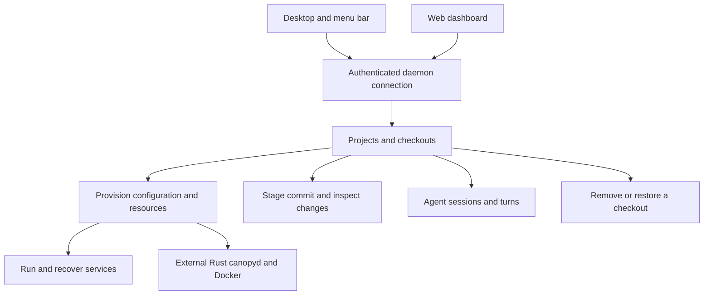

# Work on several branches without sharing their environment

Canopy lets a developer create a git worktree, run its services with separate ports and database forks, talk to coding agents, inspect changes and commit or review a branch. A worktree is another checkout of the same repository, with its own working files and index.

The Electron desktop app and web dashboard share the same UI. Both call the Node daemon, which owns local records and running operations. This Node service is sometimes called canopyd; the **separate Rust canopyd executable** supplies optional worktree and environment operations. They are distinct owners, not interchangeable implementations.

Choose a task:

- [Connect a client](connection.md), then [register a project and create a checkout](worktrees.md).
- [Provision files, ports and setup](provisioning.md), [run services](services.md), or [reset a database fork](resources.md).
- [Stage and commit changes](changes.md), [merge or use GitHub](github.md), or [review with an agent](reviews.md).
- [Continue an agent session](agents.md), [answer a tool permission](permissions.md), or [inspect and rewind edits](edits.md).
- [Use terminals and files](terminals.md), [use the desktop menu bar](desktop.md), or [remove and restore worktrees](destruction.md).
- [Find feature ownership](inventory.md) and [read current evidence](verification.md).

A returned worktree can still be provisioning. Closing an agent stream or terminal socket does not stop its underlying work. A local stopped/removed status is not a verified cleanup receipt for every external process or database. Owner pages describe these boundaries before suggesting a retry.
