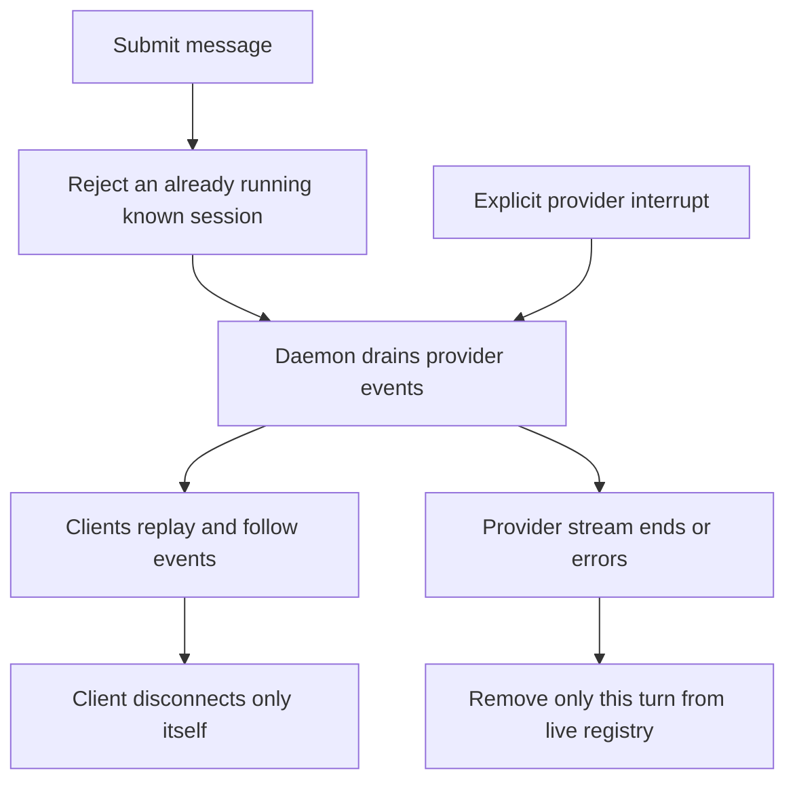

# Continue a conversation while changing screens

The Agent tab uses Claude or Codex adapters when available. A new message starts a daemon-owned turn: TurnHub drains provider events independently of the HTTP follower. Closing the tab, switching worktrees or reloading the page does not interrupt the agent. Follow the same live session to receive its buffered events and subsequent events.

## Live ownership and saved history

Known provider/session pairs admit one live turn in this registry. New sessions learn their ID from an event. Cleanup compares the stored turn identity before deleting the registry entry, so an old drain cannot erase a replacement. Buffers last for the turn lifetime; completed history comes from provider session storage, not a durable TurnHub journal.

Session listing, fleet/presence and pinning combine local records with provider evidence. Missing or unauthenticated providers contribute no sessions rather than proving none ever existed. Continuing from a removed checkout requires a real surviving cwd; the send route refuses an explicitly nonexistent directory. Provider capabilities are probed lazily and may be refreshed.

## Stop, queue and change a live turn

Interrupt, queued message and live controls are adapter operations. A no_live_turn refusal means this daemon cannot address that live provider turn; the session might have ended or be driven elsewhere. An accepted interrupt is not a rollback of files or remote actions. Inspect subsequent events and results before assuming the agent did nothing.

Tool permissions use a [separate pending-request desk](permissions.md). For file recovery use [edit evidence and rewind](edits.md). Claude SDK/terminal sessions, Codex app-server/replay and vendored agent-stream mapping have different capabilities; the unified transcript does not manufacture unsupported operations.
