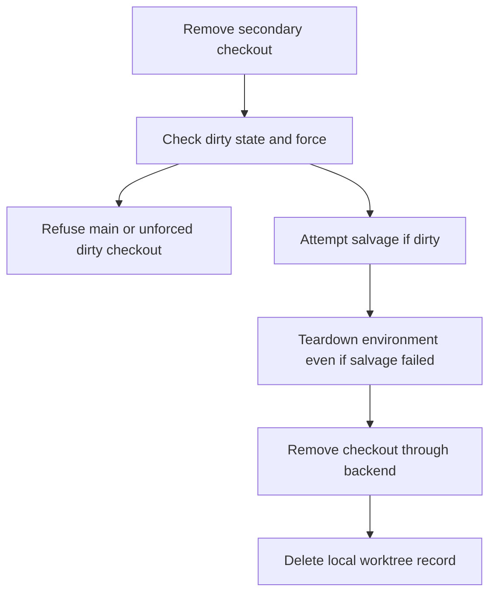

# Remove a worktree without mistaking salvage for a backup guarantee

The main checkout cannot be destroyed. For a present secondary checkout, dirty files require force. Canopy attempts to save uncommitted work under refs/canopy/salvage before proceeding, but a salvage error is logged and **does not stop destruction**. Commit or independently save work you must retain before forcing removal.

## What removal proves

Environment teardown precedes backend removal and local record deletion. It requests supervisor disposal/reaping and database destruction, releases port records and removes logs/data. Some disposal, database and log failures are caught; a missing database definition can skip its cleanup. A completed local removal therefore does not certify every external process/container/database is gone. Investigate retained resources through their actual owner when cleanup failed.

Branch deletion follows the explicit request or project policy; removing the checkout and deleting its branch are distinct effects. Missing checkouts follow a best-effort git administration cleanup path. A backend error can leave the environment already torn down while its checkout record remains; inspect the checkout before retrying.

## Background jobs and recovery

Batch removal validates each target before queueing, rejects targets held by another unfinished job, and runs items and jobs serially inside this daemon. Each item records success or failure and later items continue. Closing the dialog or reloading a browser does not cancel the job. Its registry is in memory, with completed jobs retained for ten minutes; this is not restart-durable job scheduling.

Trash entries are salvage git refs, separate from that memory registry. Restore uses a saved entry when one exists. An empty trash list does not prove force removed no valuable work: salvage is best effort and ignores effects outside its captured working-tree snapshot.
