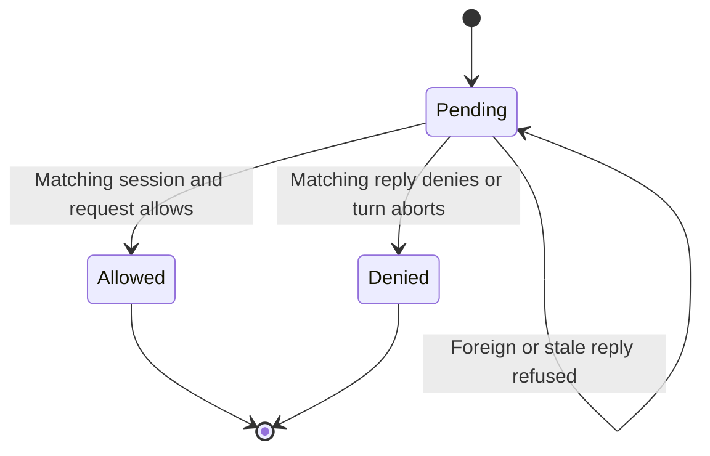

# Answer a permission in the session that asked

An agent may pause before a tool call. Use the pending request displayed for that session; the daemon routes the answer by provider, session ID and request ID. A late or duplicate answer receives unknown_permission_request when no matching prompt remains. It does not grant a future tool call permission.

## What changing autonomy can answer

PermissionDesk parks a promise under session and request. Settling removes it before resolving the provider callback. Aborting settles deny rather than leaving the SDK waiting on a rejected promise. Changing autonomy may allow pending requests, except excluded tools and prompts explicitly forced by a user's ask rule. A forced request remains for a person to answer.

This desk is one provider adapter's local pending-request mechanism. Provider capability checks and live controls determine which operations that adapter supports. It is not a proof of the provider's internal policy enforcement or arbitrary tool behavior. It assumes request IDs identify distinct outstanding asks; callers must not reuse one for concurrent requests in a session.

## Model boundary

PermissionDecision represents one pending ask and two independent composite session/request identities. It checks explicit replies match the pending identity and automatic allowance excludes a forced ask. Abort removes that ask; there is no future ask in this bound. Controls remove each matching/forced guard. It assumes unique pending keys and excludes provider internals, concurrent duplicate-key insertion, and authorization outside this adapter. All properties are finite safety checks, with terminal deadlock checking disabled and no liveness claim. See [evidence](verification.md).
