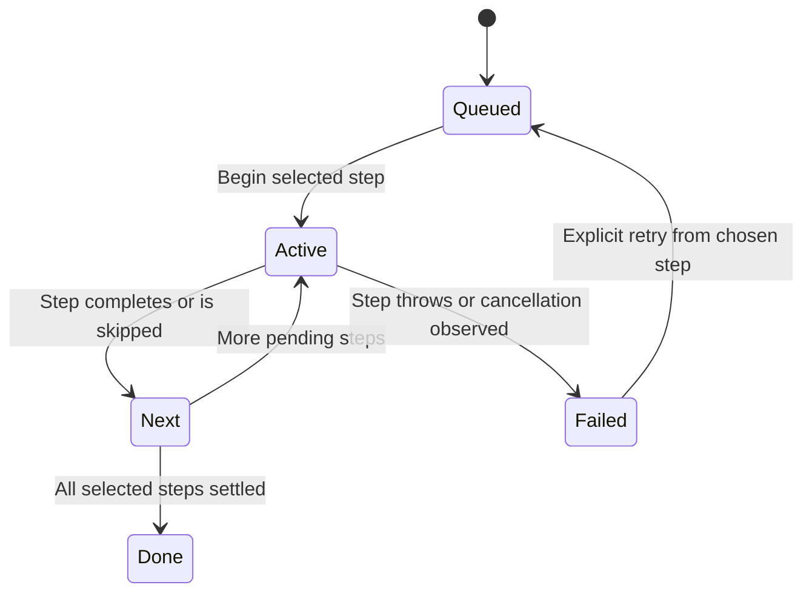

# Create a checkout, then follow provisioning

Creating a worktree inserts its local record and queues provisioning. The returned worktree is acceptance of that work, not evidence that setup finished. For example, a checkout may exist while dependency installation is still running. Follow its environment status and per-step log before starting work that needs the database or services.

## What remains after failure

The pipeline stops at the first failed step; it does not roll back earlier steps. A failing setup command may itself have changed files or remote systems. Cancellation is checked before each pending step and passed to step implementations; it does not establish that an arbitrary command performed no effects. Inspect the failed step and logs before rerunning setup with side effects.

A default retry begins at the previous failed step, or copy-files when none failed. Steps before the selected start preserve done/skipped outcomes; other earlier steps are marked skipped. These are records of what this runner chose to do, not a fresh verification that the resources still exist. The provision API returns when the run starts, while steps continue in the background.

## Configuration and ownership

canopy.yaml supplies validated service, resource and setup definitions. The settings screen can lint and scaffold it; project and per-worktree options control copying, caches and autostart. With no configuration, provisioning can still create the worktree and copy files/caches; its final environment state is none. That does not mean checkout creation failed.

The daemon resolves generated environment variables and writes .env.canopy. Ports and database fork URLs come from their [resource owners](resources.md). Existing services are stopped before reprovisioning a live environment. The daemon serializes lifecycle operations per worktree, and refuses provisioning while already creating/provisioning or destroying.

The optional Rust canopyd backend and plain-git fallback differ. The fallback creates/removes checkouts; it is not a replacement implementation of every port, database and run-control capability. Setup commands execute the repository's configured work and may require its own dependencies.

## Model boundary

ProvisionOrder represents two stages, failure of the first and an abort flag. It checks the next stage does not start after a prior failure or already-observed abort. Controls allow each forbidden continuation. It does not claim cancellation undoes an in-flight stage, that setup is idempotent, or that retry can safely repeat arbitrary external effects. Restart/retry and skipped-stage selection are outside this two-stage bound. All properties are finite safety checks, with terminal deadlock checking disabled and no liveness claim. See [evidence](verification.md).
