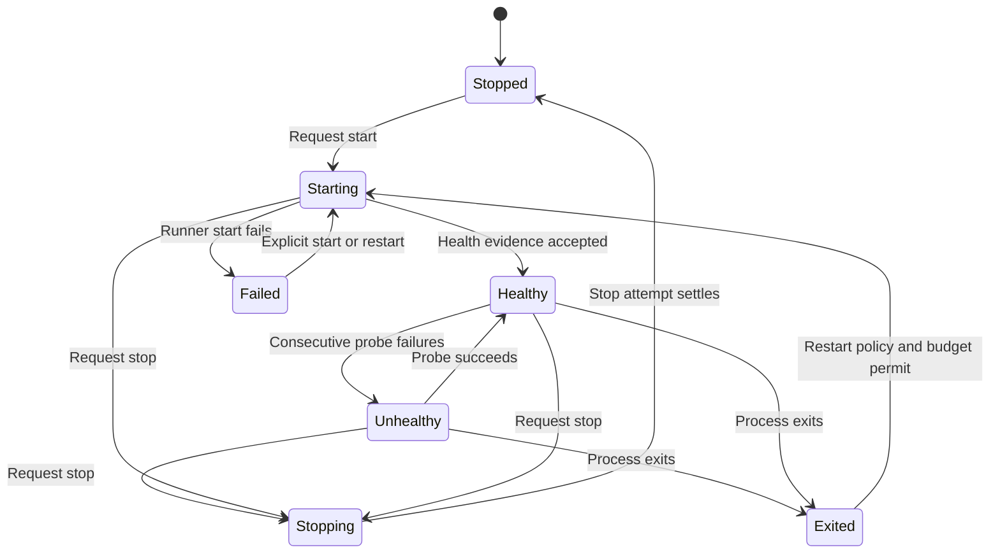

# Start services, then inspect their health

Starting an environment sets its desired state to running and starts configured services through a supervisor. A desired state records what Canopy wants; it does not prove every process is healthy. The environment is degraded when an active service is unhealthy, exited or failed. An environment with no active services can be stopped even when running was requested.

## Who owns the running process

The daemon chooses Rust canopyd run control only when its capability/configuration checks permit it; otherwise Node's WorktreeSupervisor drives host, Docker or Compose runners. A live supervisor retains ownership across a configuration change until its handles are gone. Changing settings does not transfer running processes to a different supervisor.

Node supervision expands dependencies, serializes each service's lifecycle and checks generation identities after asynchronous start/health operations and in exit callbacks. A generation is the current incarnation of that service; old callbacks must not change a replacement's status. A stale start result is stopped best effort. Health without an explicit probe is only evidence the process stayed up for a grace interval.

Restart policies distinguish never, on-failure and always. Automatic retries use bounded exponential backoff and a crash-loop budget; a deliberate restart resets that budget. Health polling does not pile up concurrent probes. This is per-service control, not an unlimited guarantee to make an unhealthy application recover.

## Stopped is not independent cleanup evidence

The Node stop path catches a runner stop error, logs it and still publishes stopped after relinquishing its handle. Inspect the supervisor log and actual process/container owner if stopping failed. The chart's Stopped state is the controller's result, not a proof no external effect or descendant remains.

Shutdown allows twelve seconds for graceful disposal, then attempts to reap previously recorded leftovers. Reaping is best effort. It persists a stopped service projection while keeping desired state. On daemon restart, interrupted provisioning is marked failed; reconciliation attempts old-record cleanup and restarts eligible desired-running environments. It skips missing checkouts and error/none states. This is recovery from records, not adoption with a proof that no duplicate external process can exist.

## Model boundary

ServiceCallback represents a single asynchronous health reply, two issued service generations and disposal. It records the generation and disposed flag at acceptance so later replacement does not invalidate earlier valid evidence. Controls remove generation/disposed checks. This models the Node health callback checks, not every start-error/exit callback, Rust canopyd behavior, process identity/reaping or absence of leaked external processes. All properties are finite safety checks, with terminal deadlock checking disabled and no liveness claim. See [evidence](verification.md).
